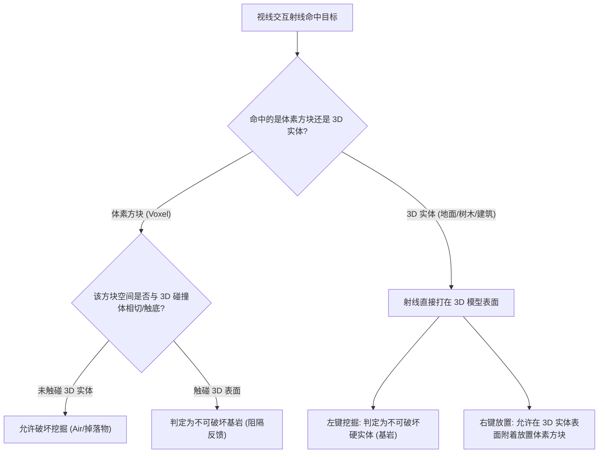
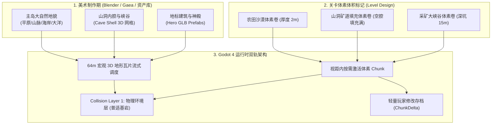

# 开放世界双轨架构方案：底层预制传统3D地形 + 上层沙盒体素世界

**文档编号**: `PLAN-003-OPEN-WORLD-TERRAIN-HYBRID`  
**版本**: 3.0 (核心进化：局部体素体积、山洞腔体填充与普适物理基岩体系)  
**状态**: 方案设计（更新评审中）  
**关联核心规范**: `specs/001-hybrid-voxel-mvp`, `specs/002-player-character-and-camera`  

---

## 1. 核心玩法定位与初衷确认

### 1.1 玩法愿景：为什么是“双轨融合”？
我们的游戏定位是 **“底层传统 3D 开放世界 + 上层沙盒体素世界”** 的创新复合形态：
- **纯体素沙盒（如 Minecraft）的短板**：
  整个世界完全由立方体堆叠，地貌缺乏精致的平滑曲面、优美的自然缓坡、平整的古道、宏伟写实的古代遗迹建筑和细腻的赛璐璐风格光影。
- **纯传统 3D 开放世界（如《塞尔达传说：旷野之息》、《上古卷轴5》、《辐射4》）的遗憾**：
  世界虽然精美绝伦、设计感十足，但整个环境完全是“静态不可变”的纸片或刚体模型。玩家不能在地上挖坑、无法掘地采矿、不能在山谷里一砖一瓦地建造属于自己的基地与防御工事。
- **我们的核心融合体验**：
  玩家游走在一个由美术精心雕琢、拥有旷野之息般美感的大自然（平原缓坡、远景苍茫山峦、海滩与神庙遗迹）；但在任意时刻，玩家都可以拿出工具对脚下的地表进行**像《我的世界》一样自由的挖掘、采集、塑形与模块化建造**。

---

## 2. 空间布局与覆盖哲学：局部体素体积（Voxel Volumes）

在真实游戏中，**绝不是所有 3D 地形都被体素均匀覆盖**，体素的分布完全由关卡设计和游戏剧情驱动：

```
+-----------------------------------------------------------------------------------+
| 空间形态 1：纯 3D 裸露区域 (Pristine 3D World)                                     |
|   - 城镇古道、石板广场、险峻山巅峭壁、硬质草坡                                      |
|   - 100% 传统精细 3D 建模，无初始体素覆盖；玩家可自由在表面“建造搭高”，不可破坏地表  |
+-----------------------------------------------------------------------------------+
| 空间形态 2：地表厚度可变地幔 (Variable-Depth Surface Mantle)                       |
|   - 农田沙漠、露天矿场、流沙沉积地、松软泥土坡                                      |
|   - 覆盖厚度由关卡设定（浅表 1~2 米薄土，深厚矿脉达 10~20 米深坑）                  |
|   - 挖开后重新暴露出底层预先精美建模的 3D 地面 (石基、地基、古道残垣)               |
+-----------------------------------------------------------------------------------+
| 空间形态 3：山洞腔体与塌方隧道填充 (Cave Chamber & Tunnel Fill)                     |
|   - 传统 3D 工具雕刻制作的大型山洞外壳 (Cave Mesh：石钟乳洞顶、坚固岩壁、洞口拱门)  |
|   - 体素不只在地形“上方”，而是填充在山洞“内部空腔” (塌方泥土、珍稀矿簇、封门巨石)  |
|   - 玩家持镐凿穿体素隧道，深入探险，洞壁岩面不可破坏 (天然硬基岩)                   |
+-----------------------------------------------------------------------------------+
```

### 2.1 剧情与探索引导机制
- **视觉线索**：松软的泥土、散落的矿渣碎石、沙丘地貌、被藤蔓与碎石封堵的洞口，自然提示玩家“此处可挖掘”；
- **游戏机制引导**：
  - 例如某任务要求解救被塌方巨石与泥土掩埋的古代矮人矿道；
  - 某个沙漠遗迹需要挖开几米深的积沙才能露出埋藏在底部的神庙大门（3D 预制体）；
  - 某个采矿峡谷存在深浅不一的铜矿与铁矿体素脉络。

---

## 3. 普适物理基岩体系（Unified Bedrock Concept）

用户提炼的核心命题：**“基岩其实隐藏在 3D 实体内部，玩家只能够在 3D 实体没有覆盖的空间挖掘与放置。”**



### 3.1 为什么必须升级为“基于物理碰撞的普适基岩”？
此前原型采用简单的 `IHeightSampler.GetHeight(x, z)` 单一浮点高度，它只能表达“单层高度场”，**完全无法处理山洞（洞顶+洞底两层）、天然石拱门或悬挑绝壁（Overhang）**。
在升级方案中：
- **基岩的唯一定义**：所有注册在 `Collision Layer 1` 的传统 3D 静态实体（地表网格、山洞岩壁、石桥、建筑墙壁、神庙石柱、大树干），其碰撞表面在物理上**天然等同于“基岩（Bedrock）”**！
- **挖掘阻隔协议（Excavation Guard）**：
  当玩家尝试挖掘某体素时，系统直接检测该体素空间是否紧贴或跨越了传统 3D 物理碰撞面；若是，则触发触底阻隔（火星特效 + 钝响音效），绝对保护底层 3D 美术网格不受侵蚀。
- **放置建造协议（Placement Protocol）**：
  玩家可以在任何 3D 实体表面（山洞岩壁、石板地面、大树干）点击右键放置方块；方块在空间网格化对齐后稳固生成，允许与树干岩壁产生自然的轻微模型穿插（沙盒游戏的标准表现）。

---

## 4. 双轨世界的完整制作与运行时流水线



### 4.1 核心管线分工总结

1. **底层 3D 预制世界**：
   - 负责整座岛屿的永久骨架、山川河流、山洞空腔与建筑地标；
   - 保证玩家无论走到哪里，哪怕不挖一块土，也是一个媲美商业大作的高品质开放世界。
2. **局部体素填充体积（Voxel Volumes）**：
   - 负责在关卡指定区域（地表农田、采矿场、山洞通道）按需填充可破坏方块；
   - 当玩家挖开体素后，露出的正是美术在体素底下预先设计并完整建模的石基底、洞穴岩壁或古道残垣。
3. **两套世界的无缝粘合**：
   - 物理统一：同一个物理层，角色奔跑起跳脚感完全一致；
   - 材质统一：同源图集与赛璐璐着色器；
   - 边界封闭：地下实心基岩与边界垂直外壁密封，杜绝任何透视穿帮。

---

## 5. 开放世界环境氛围、三平面着色、编辑器吸附与植被生态散布演化 (Feature 004)

### 5.1 晨曦天海一体与大气透视蓝雾 (Atmosphere & Horizon Fog)
- **天海地平线消除灰色断层**：在 `ProceduralSkyMaterial` 中，将 `ground_horizon_color` 与 `sky_horizon_color` 完全对齐为晨曦天青色（`#ADCDEE`），下半球 `ground_bottom_color` 设为深海纯蓝（`#144794`），彻底消除了水天交界处的默认暗灰过渡带。
- **大气透视蓝雾**：启用 `fog_enabled = true`，起雾点 `fog_depth_begin = 180.0m`，截止点 `fog_depth_end = 520.0m`。在视距边缘（640m 视野边界之前）形成柔和赛璐璐蓝白空气透视，无缝遮蔽了远处切片网格的方形几何转角与视野硬切断。

### 5.2 世界坐标三平面手绘贴图着色器 (Stylized Triplanar Shader)
- **彻底消除悬崖贴图拉伸**：升级 `terrain_triplanar.gdshader`，采用绝对世界坐标 `world_pos.zy`、`world_pos.xz`、`world_pos.xy` 分别采样无缝纹理，以四次幂锐化权重混合（`pow(abs(world_normal), 4.0)`），保证 90° 垂直悬崖、缓坡与平原过渡平滑自然。
- **草甸、沙滩、风化岩壁智能混合**：依据顶点法线坡度 `world_normal.y`（坡度阈值 0.65）混合草皮与岩石，并在海平面沙滩高度区间（$Y \le 2.2\text{m}$）自动过渡为暖黄细沙贴图。

### 5.3 Godot 编辑器内实时地形预览与 3D 资产地面吸附 (`[Tool]` Mode)
- **`[Tool]` 驱动**：在 `TiledTerrainManager`、`OceanWaterPlane` 与 `FoliageScatter` 标注 `[Tool]` 特性。
- **轻量 3x3 核心地形与碰撞体**：在编辑器模式下立即生成围绕原点的 9 块核心瓦片及 `StaticBody3D` 碰撞网格，让关卡策划打开场景即可直接看到真实起伏的地表。
- **一键地面吸附**：开发者可直接从 FileSystem 拖拽任何 3D 模型（如树木、建筑、神庙）至视口，按下快捷键 `Ctrl + Alt + S`（或点击视口工具栏磁铁吸附图标），模型即刻精确吸附贴合在地表斜坡上。

### 5.4 批量程序化植被散布 (Foliage MultiMesh)
- **单 Draw Call 批量渲染**：基于 `MultiMeshInstance3D` 散布 800+ 株赛璐璐风格卡通树木（六棱柱树干 + 三层圆锥翠绿树冠），GPU 单批次完成绘制，稳定保持 60 FPS。
- **严格生态规则过滤**：
  - 标高过滤：$Y < 2.5\text{m}$ 判定为水体与沙滩，生成率为 0%；$Y > 48.0\text{m}$ 判定为极高山巅，不生长植被；
  - 坡度过滤：法线 $\text{Normal.Y} < 0.80$（陡峭悬崖岩壁）禁止树木生成，保证所有树木只自然扎根在平缓草甸上。

---

## 6. 多样化赛璐璐植被资产体系与树木物理阻挡 (Feature 005)

### 6.1 树木与花草资产体系 (AI 生成与 Git LFS 托管)
- **核心树种变体（启发自《我的世界》经典植被）**：
  - **橡木 (Oak)**：平原与低丘陵代表性树种，枝繁叶茂，手绘翠绿树冠。
  - **云杉 (Spruce)**：高山、山脊与寒温带高耸针叶树，深绿塔伞。
  - **白桦 (Birch)**：疏林边缘与丘陵缓坡特色树种，浅白树干与鹅黄嫩绿树冠。
- **地表经典野花与草丛**：
  - **野草 (Wild Grass)**、**高草 (Tall Grass)**、**向日葵 (Sunflower)**、**虞美人 (Poppy)**、**蒲公英 (Dandelion)**。
  - 全部采用 Ludo AI 生成低多边形 3D 模型与赛璐璐贴图，存储于 `assets/models/flora/`，由 Git LFS 严格托管追踪。

### 6.2 树木物理规范与防穿模放置 (`Scale: (1, 1, 1)` 无告警)
- **规范化碰撞节点体系**：
  - 树木预制体（`res://scenes/prefabs/trees/{variant}_tree.tscn`）根节点为 `Node3D`（Scale 1:1:1）。
  - 挂载 `StaticBody3D`（Collision Layer 1: Environment）。
  - 树干绑定 `CollisionShape3D`，严格保持 `Scale: (1, 1, 1)`，仅通过 `CylinderShape3D.radius` 与 `height` 精准包裹树干，杜绝 Godot 引擎非等比缩放物理告警。
- **防穿模与角色阻挡联动**：
  - 角色移动时被树干实体阻挡，树叶树冠无碰撞，角色可顺畅在林下穿行；
  - `VoxelInteractor.PerformPlace()` 执行 1m³ 盒形物理相交查询时，树干碰撞体直接触发 `[放置受阻]` 拦截反馈，杜绝方块将树木包住穿模的违和感。

### 6.3 多变体生态分层散布器 (`FoliageScatter.cs`)
- **GPU 8 批次高效绘制 2500+ 株全岛植被**：
  - 8 款变体分别映射到独立的 `MultiMeshInstance3D` 批次通道，渲染开销控制在 8 个 Draw Calls，全岛 60 FPS 丝滑运行。
- **高程与生态位智能匹配**：
  - 橡木：集中在 3.5m ~ 28.0m 的平原与水草地带；
  - 白桦：集中在 10.0m ~ 38.0m 的林缘与丘陵；
  - 云杉：生长在 22.0m ~ 65.0m 的高峻山脊与冷杉峭壁带；
  - 花草灌木：在 2.5m ~ 45.0m 的平缓草甸（法线 $Y \ge 0.82$）点缀生长。
- **体素开采区（VoxelVolume）绝对排斥与安全缓冲**：
  - 散布器自动搜寻全场景 `VoxelVolume`（如采石场），以 AABB 外延 4.0 米设立安全缓冲带。
  - 严禁在可开采挖掘的体素矿区内生成任何静态 3D 树木与花草，彻底消除体素挖空后传统 3D 模型悬空或嵌入体素内部的问题。

### 6.4 视距内敛与空间分块迷雾遮蔽管线 (Spatial Chunking & Fog Pipeline)
- **参数数学阶梯闭环**：
  - **瓦片管理**：切比雪夫半径为 4（`ViewDistanceTiles = 4`），活动瓦片数稳定在 81 块，覆盖半径约 256m~280m。
  - **大气透视雾**：起雾点优化为 `fog_depth_begin = 180.0m`（预留通透的中近景内陆湖泊与山谷纯净视野），完全不透明点设为 `fog_depth_end = 360.0m`（在瓦片边界外平滑完全融入天际线）。
  - **大洋水面渐变**：`ocean_water.gdshader` 采用海岛径向半径与视距双重判定，内陆湖泊（径向半径 $< 260\text{m}$）零泛白，永葆清澈深蓝；仅在外围大洋（$280\text{m} \sim 460\text{m}$）处柔和消融进地平线。
  - **植被空间网格分块 (Spatial Chunking)**：
    - 将全岛植被划分为 $120\text{m} \times 120\text{m}$ 的局域网格单元，每个单元拥有独立的局部 AABB。
    - 地表野花与草丛设置 `VisibilityRangeEnd = 85.0m`，超出 85 米的单元被 Godot 渲染引擎在 CPU/GPU 层面 100% 自动跳过，消除了远景千余株亚像素花草的几何与光栅化开销。
    - 树木设置 `VisibilityRangeEnd = 260.0m`，在 260 米外的大气浓雾过渡区前自然剔除，根除远景树木突兀穿透雾气的违和感。
    - 关闭 Dither 抖动过渡（`VisibilityRangeFadeMode.Disabled`），移除着色器消融与阴影 Map 跨帧计算瓶颈。
- **收益**：
  - 内陆湖泊在任何俯瞰视角均呈现碧蓝手绘质感与岸边浪花，远景瓦片方形切片边缘与网格棱角在 360m 前被天青色晨雾 100% 优雅遮蔽。
  - 远眺视野呈现通透自然的吉卜力手绘层次感，大幅降低顶点重绘与阴影投射开销，全岛帧率稳定在 90~100+ FPS。


