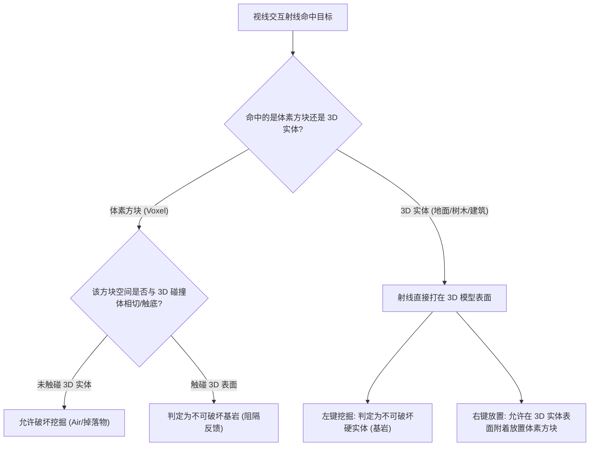
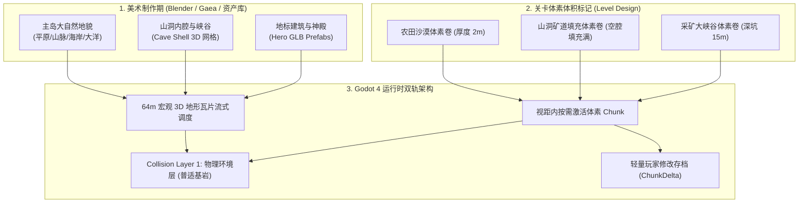

# 开放世界双轨架构方案：底层预制传统3D地形 + 上层沙盒体素世界

**文档编号**: `PLAN-003-OPEN-WORLD-TERRAIN-HYBRID`  
**版本**: 3.0 (核心进化：局部体素体积、山洞腔体填充与普适物理基岩体系)  
**状态**: 方案设计（更新评审中）  
**关联核心规范**: `specs/001-hybrid-voxel-mvp`, `specs/002-player-character-and-camera`  

---

## 1. 核心玩法定位与初衷确认

### 1.1 玩法愿景：为什么是“双轨融合”？
我们的游戏定位是 **“底层传统 3D 开放世界 + 上层沙盒体素世界”** 的创新复合形态：
- **纯体素沙盒（如 Minecraft）的短板**：
  整个世界完全由立方体堆叠，地貌缺乏精致的平滑曲面、优美的自然缓坡、平整的古道、宏伟写实的古代遗迹建筑和细腻的赛璐璐风格光影。
- **纯传统 3D 开放世界（如《塞尔达传说：旷野之息》、《上古卷轴5》、《辐射4》）的遗憾**：
  世界虽然精美绝伦、设计感十足，但整个环境完全是“静态不可变”的纸片或刚体模型。玩家不能在地上挖坑、无法掘地采矿、不能在山谷里一砖一瓦地建造属于自己的基地与防御工事。
- **我们的核心融合体验**：
  玩家游走在一个由美术精心雕琢、拥有旷野之息般美感的大自然（平原缓坡、远景苍茫山峦、海滩与神庙遗迹）；但在任意时刻，玩家都可以拿出工具对脚下的地表进行**像《我的世界》一样自由的挖掘、采集、塑形与模块化建造**。

---

## 2. 空间布局与覆盖哲学：局部体素体积（Voxel Volumes）

在真实游戏中，**绝不是所有 3D 地形都被体素均匀覆盖**，体素的分布完全由关卡设计和游戏剧情驱动：

```
+-----------------------------------------------------------------------------------+
| 空间形态 1：纯 3D 裸露区域 (Pristine 3D World)                                     |
|   - 城镇古道、石板广场、险峻山巅峭壁、硬质草坡                                      |
|   - 100% 传统精细 3D 建模，无初始体素覆盖；玩家可自由在表面“建造搭高”，不可破坏地表  |
+-----------------------------------------------------------------------------------+
| 空间形态 2：地表厚度可变地幔 (Variable-Depth Surface Mantle)                       |
|   - 农田沙漠、露天矿场、流沙沉积地、松软泥土坡                                      |
|   - 覆盖厚度由关卡设定（浅表 1~2 米薄土，深厚矿脉达 10~20 米深坑）                  |
|   - 挖开后重新暴露出底层预先精美建模的 3D 地面 (石基、地基、古道残垣)               |
+-----------------------------------------------------------------------------------+
| 空间形态 3：山洞腔体与塌方隧道填充 (Cave Chamber & Tunnel Fill)                     |
|   - 传统 3D 工具雕刻制作的大型山洞外壳 (Cave Mesh：石钟乳洞顶、坚固岩壁、洞口拱门)  |
|   - 体素不只在地形“上方”，而是填充在山洞“内部空腔” (塌方泥土、珍稀矿簇、封门巨石)  |
|   - 玩家持镐凿穿体素隧道，深入探险，洞壁岩面不可破坏 (天然硬基岩)                   |
+-----------------------------------------------------------------------------------+
```

### 2.1 剧情与探索引导机制
- **视觉线索**：松软的泥土、散落的矿渣碎石、沙丘地貌、被藤蔓与碎石封堵的洞口，自然提示玩家“此处可挖掘”；
- **游戏机制引导**：
  - 例如某任务要求解救被塌方巨石与泥土掩埋的古代矮人矿道；
  - 某个沙漠遗迹需要挖开几米深的积沙才能露出埋藏在底部的神庙大门（3D 预制体）；
  - 某个采矿峡谷存在深浅不一的铜矿与铁矿体素脉络。

---

## 3. 普适物理基岩体系（Unified Bedrock Concept）

用户提炼的核心命题：**“基岩其实隐藏在 3D 实体内部，玩家只能够在 3D 实体没有覆盖的空间挖掘与放置。”**



### 3.1 为什么必须升级为“基于物理碰撞的普适基岩”？
此前原型采用简单的 `IHeightSampler.GetHeight(x, z)` 单一浮点高度，它只能表达“单层高度场”，**完全无法处理山洞（洞顶+洞底两层）、天然石拱门或悬挑绝壁（Overhang）**。
在升级方案中：
- **基岩的唯一定义**：所有注册在 `Collision Layer 1` 的传统 3D 静态实体（地表网格、山洞岩壁、石桥、建筑墙壁、神庙石柱、大树干），其碰撞表面在物理上**天然等同于“基岩（Bedrock）”**！
- **挖掘阻隔协议（Excavation Guard）**：
  当玩家尝试挖掘某体素时，系统直接检测该体素空间是否紧贴或跨越了传统 3D 物理碰撞面；若是，则触发触底阻隔（火星特效 + 钝响音效），绝对保护底层 3D 美术网格不受侵蚀。
- **放置建造协议（Placement Protocol）**：
  玩家可以在任何 3D 实体表面（山洞岩壁、石板地面、大树干）点击右键放置方块；方块在空间网格化对齐后稳固生成，允许与树干岩壁产生自然的轻微模型穿插（沙盒游戏的标准表现）。

---

## 4. 双轨世界的完整制作与运行时流水线



### 4.1 核心管线分工总结

1. **底层 3D 预制世界**：
   - 负责整座岛屿的永久骨架、山川河流、山洞空腔与建筑地标；
   - 保证玩家无论走到哪里，哪怕不挖一块土，也是一个媲美商业大作的高品质开放世界。
2. **局部体素填充体积（Voxel Volumes）**：
   - 负责在关卡指定区域（地表农田、采矿场、山洞通道）按需填充可破坏方块；
   - 当玩家挖开体素后，露出的正是美术在体素底下预先设计并完整建模的石基底、洞穴岩壁或古道残垣。
3. **两套世界的无缝粘合**：
   - 物理统一：同一个物理层，角色奔跑起跳脚感完全一致；
   - 材质统一：同源图集与赛璐璐着色器；
   - 边界封闭：地下实心基岩与边界垂直外壁密封，杜绝任何透视穿帮。
