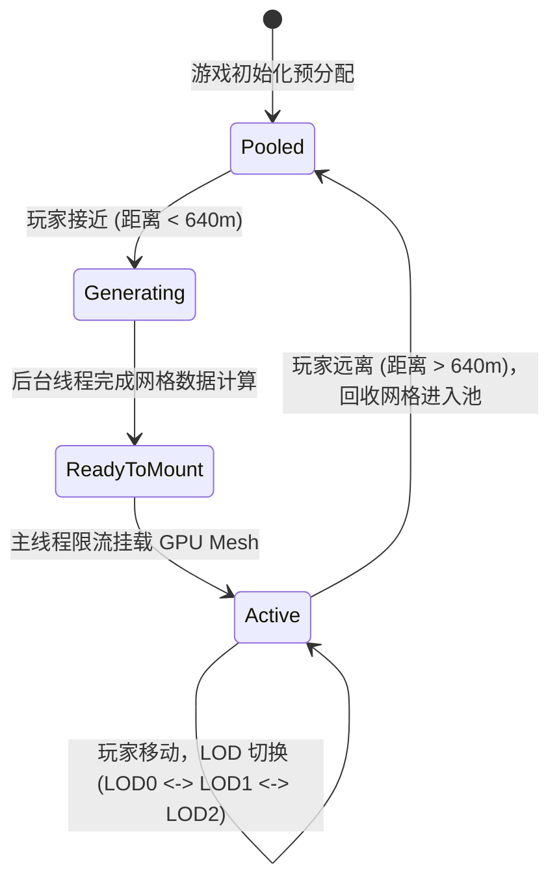
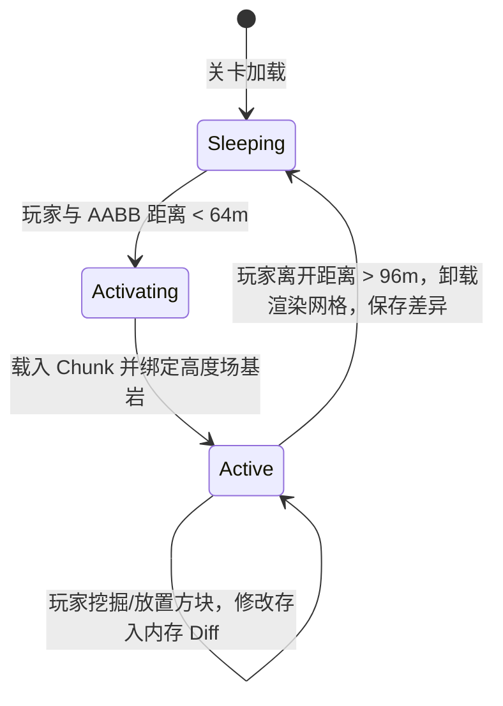

# Phase 1: Data Model & Schema Specification

**Feature**: `003-hybrid-open-world-terrain`  
**Date**: 2026-11-07  
**Status**: Completed  

---

## 1. 核心实体模型 (Core Domain Entities)

### 1.1 IslandHeightSamplerConfig (海岛高度场配置值对象)

定义千米级海岛高度场的数学参数与分形层次。

```csharp
namespace Celestial.Terrain;

public record struct IslandHeightSamplerConfig
{
    public int Seed { get; init; } = 1337;
    public float IslandRadius { get; init; } = 380.0f;       // 核心陆地半径（米）
    public float CoastlineRadius { get; init; } = 460.0f;    // 海滩渐变至海平面半径（米）
    public float SeaLevel { get; init; } = 0.0f;             // 海平面绝对基准高度（米）
    public float OceanBedDepth { get; init; } = -18.0f;      // 外围大洋底面深度（米）

    // 宏观平原微波
    public float PlainsFrequency { get; init; } = 0.004f;    // 约 250m 波长
    public float PlainsAmplitude { get; init; } = 8.0f;      // 起伏幅度 8 米
    public float PlainsBaseHeight { get; init; } = 5.0f;     // 平原基底标高

    // 内陆山脊
    public float MountainFrequency { get; init; } = 0.0025f; // 约 400m 波长
    public float MountainAmplitude { get; init; } = 65.0f;   // 山峰最大拔高
    public Vector2 MountainCenterOffset { get; init; } = new(100.0f, -80.0f); // 山体偏心向量

    // 微观细节
    public float DetailFrequency { get; init; } = 0.05f;     // 约 20m 波长
    public float DetailAmplitude { get; init; } = 1.8f;      // 微观细节起伏

    public IslandHeightSamplerConfig() { }
}
```

---

### 1.2 TerrainTileCoord (瓦片坐标键值)

大世界瓦片的离散空间坐标，作为字典键支持快速查找与哈希。

```csharp
namespace Celestial.Terrain;

public readonly record struct TerrainTileCoord(int X, int Z)
{
    public Vector3 ToWorldOrigin(float tileSize = 64.0f) =>
        new(X * tileSize, 0.0f, Z * tileSize);

    public Vector3 ToWorldCenter(float tileSize = 64.0f) =>
        new((X + 0.5f) * tileSize, 0.0f, (Z + 0.5f) * tileSize);

    public int ChebyshevDistance(TerrainTileCoord other) =>
        Math.Max(Math.Abs(X - other.X), Math.Abs(Z - other.Z));

    public float EuclideanDistance(Vector3 worldPos, float tileSize = 64.0f)
    {
        var center = ToWorldCenter(tileSize);
        float dx = worldPos.X - center.X;
        float dz = worldPos.Z - center.Z;
        return MathF.Sqrt(dx * dx + dz * dz);
    }
}
```

---

### 1.3 LODLevel (视距级别枚举)

```csharp
namespace Celestial.Terrain;

public enum LODLevel
{
    LOD0_Near = 0,    // 0 ~ 96m: 步长 1m, 8192 三角面, 包含物理碰撞体
    LOD1_Mid = 1,     // 96 ~ 320m: 步长 4m, 512 三角面, 仅渲染无物理碰撞
    LOD2_Far = 2,     // 320 ~ 640m: 步长 16m, 32 三角面, 远景低模天际线
    Unloaded = 3      // > 640m: 卸载或放入对象池
}
```

---

### 1.4 RawTileMeshData (异步网格计算结果传输对象)

后台工作线程计算完成、准备传递给主线程进行 GPU 绑定的纯数值缓冲区，完全杜绝在后台线程调用 Godot API。

```csharp
namespace Celestial.Terrain;

public sealed class RawTileMeshData
{
    public TerrainTileCoord Coord { get; init; }
    public LODLevel LOD { get; init; }
    public Vector3[] Vertices { get; set; } = Array.Empty<Vector3>();
    public Vector3[] Normals { get; set; } = Array.Empty<Vector3>();
    public Vector2[] UVs { get; set; } = Array.Empty<Vector2>();
    public int[] Indices { get; set; } = Array.Empty<int>();
    public float MinY { get; set; }
    public float MaxY { get; set; }
    public bool HasCollider => LOD == LODLevel.LOD0_Near;
}
```

---

### 1.5 VoxelVolumeDefinition (局部体素卷配置与边界)

```csharp
namespace Celestial.Voxel;

public sealed class VoxelVolumeDefinition
{
    public string VolumeId { get; init; } = "default_volume";
    public Aabb WorldBounds { get; init; }                      // 体素卷覆盖的世界 AABB 包围盒
    public float VoxelSize { get; init; } = 1.0f;               // 标准体素尺寸 1.0m
    public bool AutoAnchorToTerrain { get; init; } = true;      // 是否自动将底部与 3D 地形高度贴合
    public VoxelType DefaultFillType { get; init; } = VoxelType.Dirt; // 默认填充类型
    public float ActivationRadius { get; init; } = 64.0f;       // 激活距离（玩家接近此距离时挂载）
}
```

---

### 1.6 HitType & InteractionRaycastResult (射线交互判定结果)

```csharp
namespace Celestial.Interaction;

public enum HitType
{
    None = 0,
    Voxel = 1,        // 可破坏/可放置体素方块
    Bedrock = 2       // 不可破坏基岩屏障（传统 3D 实体表面、底层天然地表）
}

public readonly record struct InteractionRaycastResult
{
    public HitType Type { get; init; }
    public Vector3 HitPoint { get; init; }
    public Vector3 HitNormal { get; init; }
    public Vector3I TargetVoxelCoord { get; init; }   // 挖掘目标方块坐标（仅当 Type == Voxel 时有效）
    public Vector3I PlaceVoxelCoord { get; init; }    // 放置吸附目标方块坐标
    public GodotObject? HitObject { get; init; }
}
```

---

## 2. 状态机与生命周期迁移 (State Transitions)

### 2.1 TerrainTile 生命周期



### 2.2 VoxelVolume 激活与休眠



---

## 3. 校验规则 (Validation Rules)

1. **瓦片边界高度连续性校验**:
   - 相邻瓦片在边界处的顶点高度采样值必须严格相等：
     $H_{\text{Tile}(x, z)}(64, y) \equiv H_{\text{Tile}(x+1, z)}(0, y)$。
   - 依赖数学采样器确定性计算，同一坐标在不同 LOD 瓦片生成的基准高度误差为 $0.000\text{m}$。
2. **基岩不可侵入规则**:
   - 任何针对处于 $Y \le H_{\text{terrain}}(x, z)$ 的挖掘请求均被系统拦截，禁止在底层 3D 网格内部产生空洞。
3. **放置碰撞体相交防穿插规则**:
   - 放置新方块前，对放置目标方块 AABB $[P_{\min}, P_{\max}]$ 与角色胶囊体进行相交测试，相交时禁止放置，防止角色自身被方块卡住。

