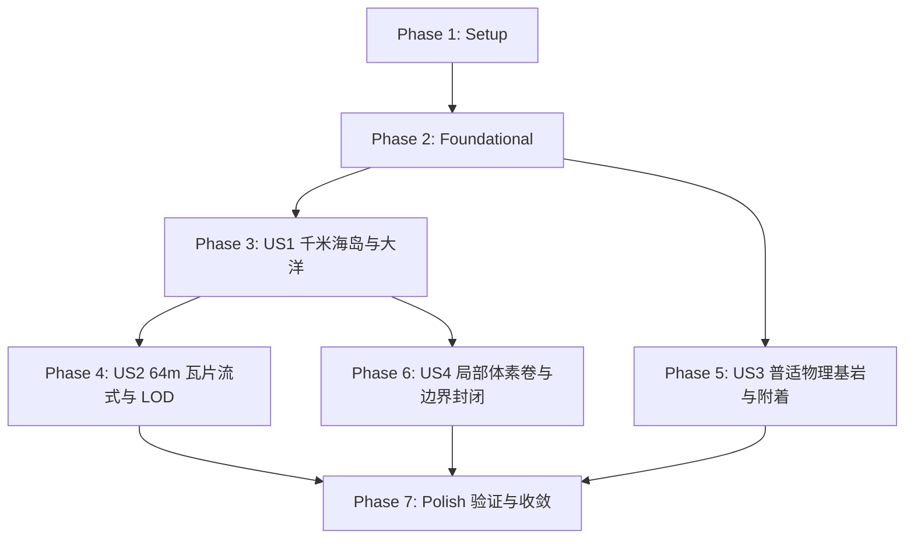

# Tasks: Hybrid Open-World Terrain, Tiled Streaming & Voxel Volumes

**Feature**: `003-hybrid-open-world-terrain`  
**Input**: Design documents from `/specs/003-hybrid-open-world-terrain/` (`spec.md`, `plan.md`, `research.md`, `data-model.md`, `contracts/`, `quickstart.md`)  
**Prerequisites**: `plan.md` (completed), `spec.md` (completed)  

---

## Format: `- [ ] [ID] [P?] [Story?] Description with file path`

- **[P]**: 可并行执行（不同文件，无未完成任务依赖）
- **[Story]**: 所属用户故事标签（`[US1]`, `[US2]`, `[US3]`, `[US4]`）
- 包含精确的文件路径

---

## Phase 1: Setup (Shared Infrastructure)

**Purpose**: 初始化大地形模块目录结构与着色器资源基础

- [x] T001 创建开放世界大地形代码目录结构在 `src/Terrain/`
- [x] T002 [P] 初始化大洋与三平面地形着色器空模板在 `shaders/ocean_water.gdshader` 和 `shaders/terrain_triplanar.gdshader`

---

## Phase 2: Foundational (Blocking Prerequisites)

**Purpose**: 核心数据结构、枚举与基础契约，所有用户故事的前置依赖

**⚠️ CRITICAL**: 在本阶段完成前，不得开始用户故事的具体业务实现

- [x] T003 [P] 实现瓦片离散空间坐标与距离计算结构体 `TerrainTileCoord` 在 `src/Terrain/TerrainTileCoord.cs`
- [x] T004 [P] 实现视距等级枚举 `LODLevel` 与异步网格数值传输对象 `RawTileMeshData` 在 `src/Terrain/RawTileMeshData.cs`
- [x] T005 [P] 实现物理拾取判定结果结构体 `InteractionRaycastResult` 与 `HitType` 在 `src/Player/InteractionRaycastResult.cs`
- [x] T006 扩展地表采样契约接口 `IHeightSampler`（增加海平面、生成种子与水下判定）在 `src/Terrain/IHeightSampler.cs`

**Checkpoint**: 基础数据结构与契约完备，各用户故事可按依赖顺序开启

---

## Phase 3: User Story 1 - 千米级海岛地貌与无垠大洋环绕 (Priority: P1) 🎯 MVP

**Goal**: 构建 $1024\text{m} \times 1024\text{m}$ 复合海岛高度场与 $Y=0.0\text{m}$ 海平面大洋系统，呈现开阔平原、内陆山脊、沙滩与环岛大洋。

**Independent Test**: 运行自动化采样测试 `tests/test_island_height_sampler.gd`，验证中心平原标高、东北内陆山脊顶峰、海滩平滑沉入大洋，以及 10,000 次采样连续性。

- [x] T007 [P] [US1] 编写海岛分形采样器自动化验证脚本在 `tests/test_island_height_sampler.gd`
- [x] T008 [US1] 实现千米海岛复合分形采样器 `IslandHeightSampler`（径向衰减遮罩、平原微波、内陆山峰分形）在 `src/Terrain/IslandHeightSampler.cs`
- [x] T009 [P] [US1] 实现赛璐璐手绘水体 Shader（深度碧蓝阶梯渐变、海岸浪花白边、阶梯高光）在 `shaders/ocean_water.gdshader`
- [x] T010 [US1] 实现全局海平面水体节点 `OceanWaterPlane`（$2048\text{m}$ 水平 Quad，跟随玩家视角平移）在 `src/Terrain/OceanWaterPlane.cs`
- [x] T011 [US1] 在主场景集成 `OceanWaterPlane` 与 `IslandHeightSampler` 在 `scenes/main.tscn`

**Checkpoint**: 此时千米海岛高度场与全局大洋渲染已就绪，可在全岛进行标高查询与大洋视效展示

---

## Phase 4: User Story 2 - 64米瓦片异步流式加载与视距 LOD 网格 (Priority: P1)

**Goal**: 实现 64m 宏观瓦片切片划分、后台多线程并发网格计算、主线程限流挂载（$\le 3\text{ms}$/帧）、三级视距 LOD（1m/4m/16m 步长）与对象池回收。

**Independent Test**: 运行 `tests/test_tiled_terrain_streaming.gd`，验证角色以 $20\text{m/s}$ 移动时瓦片动态挂载卸载、活动瓦片数恒定、主线程耗时 $< 3\text{ms}$。

- [x] T012 [P] [US2] 编写瓦片流式加载与 LOD 调度自动化测试脚本在 `tests/test_tiled_terrain_streaming.gd`
- [x] T013 [P] [US2] 实现赛璐璐三平面投影着色器（坡度平滑过渡草地与岩石纹理）在 `shaders/terrain_triplanar.gdshader`
- [x] T014 [US2] 实现单体瓦片节点 `TerrainTile`（支持多级 ArrayMesh 绑定、LOD0 碰撞体生成与对象池重置）在 `src/Terrain/TerrainTile.cs`
- [x] T015 [US2] 在后台线程池实现基于 `IHeightSampler` 的高效多线程网格顶点与法线计算逻辑在 `src/Terrain/RawTileMeshData.cs`
- [x] T016 [US2] 实现瓦片流式调度管理器 `TiledTerrainManager`（视距半径、并发任务池、单帧 $\le 3\text{ms}$ 限流队列、瓦片对象池）在 `src/Terrain/TiledTerrainManager.cs`
- [x] T017 [US2] 重构主场景 `scenes/main.tscn` 与 `src/Core/GameManager.cs`，用 `TiledTerrainManager` 替换旧版 `StaticTerrain`

**Checkpoint**: 此时千米海岛具备无缝流式调度与视距 LOD 网格，角色可在全岛自由奔跑，帧率稳定在 60 FPS

---

## Phase 5: User Story 3 - 普适物理基岩与 3D 实体建造附着 (Priority: P2)

**Goal**: 统一大世界物理碰撞层级（`Collision Layer 1: Environment`），射线命中传统 3D 地形与静态实体判定为不可破坏基岩，左键阻隔并出火星，右键沿表面法线外侧吸附放置方块。

**Independent Test**: 运行 `tests/test_bedrock_interaction.gd`，验证对准 3D 实体挖掘禁止破坏，右键对准 3D 表面可在法线外侧整型网格精准生成新方块。

- [x] T018 [P] [US3] 编写基岩碰撞与 3D 表面吸附放置自动化测试脚本在 `tests/test_bedrock_interaction.gd`
- [x] T019 [US3] 实现普适物理基岩检测器 `BedrockPhysicsDetector`（基于 Layer 1 碰撞体与高度场判定 HitType）在 `src/Player/BedrockPhysicsDetector.cs`
- [x] T020 [US3] 重构射线交互控制器 `VoxelInteractor.cs`（集成基岩阻隔反馈粒子与 3D 表面法线对齐放置）在 `src/Player/VoxelInteractor.cs`
- [x] T021 [US3] 调优角色在纯 3D 地面与附着搭建体素平台之间的连续行走与跳跃碰撞在 `src/Player/PlayerController.cs`

**Checkpoint**: 此时所有传统 3D 实体天然充当基岩骨架，且支持在其表面自由附着搭建体素台阶与平台

---

## Phase 6: User Story 4 - 局部体素体积 (Voxel Volumes) 按需激活与边界封闭 (Priority: P2)

**Goal**: 实现局部体素卷 `VoxelVolume`，在采矿区或山洞按需激活；与 3D 地形高度紧密嵌合，地下体素判定为实心基岩，挖掘到底时四周生成闭合侧壁，彻底根除漏面透视。

**Independent Test**: 运行 `tests/test_voxel_volume_meshing.gd`，在局部体素卷内挖坑至 3D 地表，验证侧壁网格面封闭完整率 100%，底层无透视镂空。

- [x] T022 [P] [US4] 编写局部体素卷网格边界封闭性自动化测试脚本在 `tests/test_voxel_volume_meshing.gd`
- [x] T023 [P] [US4] 定义局部体素卷契约接口 `IVoxelVolume` 在 `src/Voxel/IVoxelVolume.cs`
- [x] T024 [US4] 实现局部体素卷节点 `VoxelVolume`（空间 AABB 包围盒、玩家接近激活/远离休眠、差异持久化）在 `src/Voxel/VoxelVolume.cs`
- [x] T025 [US4] 升级体素网格生成器 `ChunkMesher.cs` 与 `VoxelChunk.cs`，实现地表以下实心基岩邻居判定与露底侧面完整闭合在 `src/Voxel/ChunkMesher.cs`
- [x] T026 [US4] 在主场景的岛屿平原区域布置一处典型采矿场 `VoxelVolume` 实例在 `scenes/main.tscn`

**Checkpoint**: 此时局部体素卷与 3D 地面完美嵌合，玩家可开采矿坑，四壁封闭严实，无任何透视或边界破面

---

## Phase 7: Polish & Cross-Cutting Concerns

**Purpose**: 工程全量编译、多用例回归验证、调试监控面板集成与文档归档

- [x] T027 [P] 执行工程 C# 全量编译构建验证在终端运行 `DOTNET_CLI_HOME=/tmp/dotnet_home dotnet build celestial.csproj`
- [x] T028 [P] 批量执行 `quickstart.md` 中所有自动化测试套件在 `tests/`
- [x] T029 升级游戏内 `F3` 调试监控面板（增加活动瓦片数、流式队列长度、内存与 DrawCalls 监控）在 `src/Core/DebugOverlay.cs`
- [x] T030 归档最终架构落地细节并同步更新大地图设计文档在 `docs/plan/open_world_terrain_and_streaming_architecture.md`

---

## Dependencies & Execution Order

### Phase Dependencies

### User Story Dependencies

- **User Story 1 (P1)**: 依赖 Phase 2 基础契约，为整个大世界提供地貌高度与水体，必须首先完成。
- **User Story 2 (P1)**: 依赖 User Story 1 的 `IslandHeightSampler` 提供高度输入，实现瓦片化切片与流式。
- **User Story 3 (P2)**: 依赖 Phase 2 的 `InteractionRaycastResult` 与 Layer 1 碰撞约定，可与 US2 并行或紧随其后。
- **User Story 4 (P2)**: 依赖 User Story 1 的 `IslandHeightSampler` 实现地表以下基岩判定，可与 US3 并行。

---

## Parallel Opportunities

- **Setup & Foundation**:
  - `T001` (目录创建) 与 `T002` (Shader 文件) 可并行。
  - `T003`, `T004`, `T005` 可并行执行。
- **User Story 1**:
  - 测试脚本 `T007`、采样器 `T008` 与水体 Shader `T009` 可并行推进。
- **User Story 2**:
  - 测试脚本 `T012`、三平面着色器 `T013` 与网格数值计算 `T015` 可并行编写。
- **User Story 3 & 4**:
  - `T018` 与 `T022` 测试脚本可并行编写。
  - `T019` 基岩检测器与 `T023` 体素卷接口可并行编写。

---

## Implementation Strategy

### MVP 最小可行发布 (User Story 1 + User Story 2)
1. 完成 Phase 1（Setup）与 Phase 2（Foundational）。
2. 完成 Phase 3（User Story 1: 千米海岛与全局大洋）。
3. 完成 Phase 4（User Story 2: 64m 瓦片异步流式与三级 LOD）。
4. **运行验证**: 角色可在千米大岛上长距离奔跑漫游，60 FPS 流畅无卡顿，海平面与远山轮廓清晰。

### 增量扩展阶段 (User Story 3 + User Story 4)
5. 完成 Phase 5（普适基岩与 3D 表面附着搭建），统一破坏阻隔与搭建能力。
6. 完成 Phase 6（局部体素卷），在岛上投放采矿区，彻底根除地下透视。
7. 完成 Phase 7（构建自测与 F3 性能监控面板升级）。
