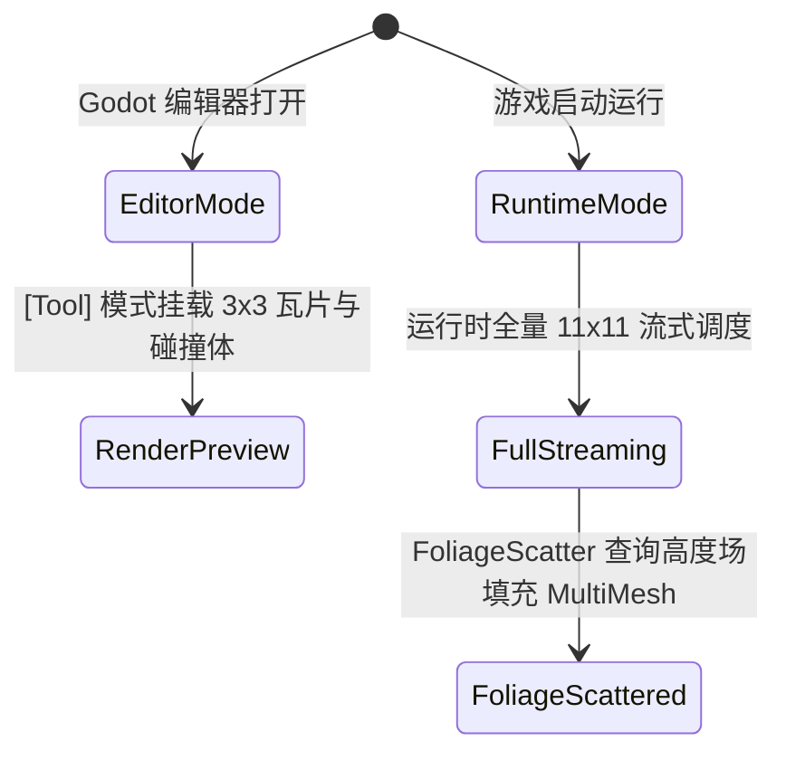

# Phase 1: Data Model & Schema Specification

**Feature**: `004-environment-and-foliage`  
**Date**: 2026-11-07  
**Status**: Completed  

---

## 1. 核心模型与配置

### 1.1 FoliageScatterConfig (植被散布配置)

```csharp
namespace Celestial.Terrain;

public record struct FoliageScatterConfig
{
    public int InstanceCount { get; init; } = 800;             // 单个批次散布数量
    public float ScatterRadius { get; init; } = 320.0f;        // 散布辐射半径
    public float MinSpawnHeight { get; init; } = 2.0f;         // 最低生长高度 (避开水下与沙滩)
    public float MaxSpawnHeight { get; init; } = 45.0f;        // 最高生长高度 (避开雪线/极高岩壁)
    public float MinSlopeNormalY { get; init; } = 0.80f;       // 最低垂直度 (法线 Y >= 0.80，防止长在悬崖上)
    public Vector2 ScaleRange { get; init; } = new(0.8f, 1.4f); // 尺寸微随机范围
    public int Seed { get; init; } = 2026;
}
```

### 1.2 EnvironmentAtmosphereSettings (开放世界大气环境参数)

```text
Fog:
  Enabled: true
  LightColor: Color(0.68, 0.82, 0.95, 1.0)
  Density: 0.002
  DepthBegin: 180.0m
  DepthEnd: 520.0m

Sky:
  SkyTopColor: Color(0.35, 0.62, 0.96, 1.0)
  SkyHorizonColor: Color(0.68, 0.82, 0.95, 1.0)
  GroundBottomColor: Color(0.08, 0.28, 0.58, 1.0)
  GroundHorizonColor: Color(0.68, 0.82, 0.95, 1.0)
```

---

## 2. 状态机与生命周期



